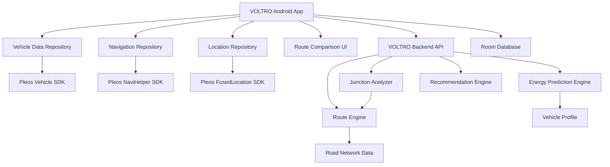

# VOLTRO — MVP 개발 명세서

**Version:** 1.0.0  
**Project:** VOLTRO (볼트로)  
**Platform:** Pleos Connect / Android Automotive OS  
**Primary Language:** Kotlin  
**Backend:** Python / FastAPI  
**Document Type:** MVP Product & Technical Specification  
**Status:** Development Ready — SDK 검증 항목 포함

---

# 1. 프로젝트 개요

## 1.1 서비스 소개

VOLTRO는 전기차의 배터리 상태와 도로 환경을 분석하여 출발 전 경로별 예상 에너지 소비량을 비교하고, 주행 중 주요 분기점에서 더 효율적인 경로를 안내하는 차량용 애플리케이션이다.

**브랜드 슬로건:** Your Route. Your Energy.

## 1.2 핵심 문제

기존 내비게이션은 주로 이동 시간과 거리를 중심으로 경로를 비교한다.

전기차는 주행속도, 도로 경사, 교통 상황 등에 따라 에너지 소비량이 달라지지만 운전자는 경로별 소비 전력을 직접 비교하기 어렵다.

VOLTRO는 경로 선택 과정에 에너지 소비량이라는 새로운 판단 기준을 제공한다.

## 1.3 MVP 개발 목표

MVP에서는 다음 네 가지를 검증한다.

1. 차량의 배터리 및 전비 정보를 기반으로 경로별 예상 소비 전력을 계산할 수 있는가?
2. 운전자가 출발 전 복수 경로의 시간과 에너지 소비량을 직관적으로 비교할 수 있는가?
3. 주행 중 주요 분기점에서 대체 경로의 에너지 절약 효과를 계산하고 안내할 수 있는가?
4. 실제 주행 결과와 예측값을 비교할 수 있는가?

## 1.4 MVP 완료 기준

다음 사용자 흐름이 처음부터 끝까지 동작해야 한다.

```text
앱 실행
   ↓
차량 배터리 정보 확인
   ↓
목적지 입력
   ↓
후보 경로 2~3개 생성
   ↓
경로별 에너지 소비량 계산
   ↓
경로 비교 화면 표시
   ↓
사용자 경로 선택
   ↓
주행 상태 추적
   ↓
주요 분기점 감지
   ↓
대체 경로 에너지 비교
   ↓
분기점 절약 정보 안내
   ↓
목적지 도착
   ↓
주행 결과 리포트
```

실차 데이터 접근 또는 내비게이션 경로 변경이 지원되지 않더라도 Mock 주행 모드로 전체 흐름을 시연할 수 있어야 한다.

---

# 2. MVP 개발 범위

## 2.1 필수 기능 (P0)

| ID | 기능 | 설명 |
|---|---|---|
| F-001 | 차량 정보 조회 | SOC, 전비, 배터리 용량 확인 |
| F-002 | 목적지 입력 | 목적지 검색 및 선택 |
| F-003 | 후보 경로 생성 | 최소 2개 경로 생성 |
| F-004 | 에너지 소비 예측 | 경로별 예상 kWh 계산 |
| F-005 | 도착 SOC 예측 | 경로별 예상 잔량 계산 |
| F-006 | 경로 비교 UI | 거리, 시간, 소비량 비교 |
| F-007 | 경로 추천 | 에너지 효율 기반 추천 |
| F-008 | 주행 상태 추적 | 현재 위치 및 경로 진행 상태 |
| F-009 | 주요 분기점 탐지 | 대체 경로가 존재하는 분기점 감지 |
| F-010 | 분기점 에너지 비교 | 현재 경로와 대체 경로 비교 |
| F-011 | 안전한 분기점 안내 | 간결한 정보 표시, 중복 방지 |
| F-012 | Mock 주행 모드 | 차량 없이 핵심 흐름 시연 |

## 2.2 권장 기능 (P1)

| ID | 기능 | 설명 |
|---|---|---|
| F-013 | Pleos 내비 연동 | 지원 가능한 경로 옵션 및 경유지 사용 |
| F-014 | 음성 안내 | TTS를 통한 절약량 안내 |
| F-015 | 주행 리포트 | 예측값과 실제값 비교 |
| F-016 | 주행 이력 저장 | 최근 경로 분석 기록 |
| F-017 | 최소 도착 SOC | 사용자 지정 안전 잔량 |
| F-018 | 데이터 오류 대응 | 위치·차량 정보 수신 실패 처리 |

## 2.3 MVP 제외 기능

다음 기능은 최초 MVP 개발 범위에서 제외한다.

- AI 기반 운전자별 전비 학습
- 충전소 자동 경유 최적화
- 실시간 충전소 예약
- 날씨 기반 고급 전비 예측
- 차량 원격 제어
- 다중 차량 운행 관리
- 사용자 계정 및 클라우드 동기화
- 차량 배터리 열화 예측
- 결제 및 구독 시스템

---

# 3. 기술 아키텍처

## 3.1 전체 시스템 구조



## 3.2 구성 원칙

- 차량 SDK 접근 코드는 Adapter 계층으로 분리한다.
- UI 계층은 Pleos SDK에 직접 의존하지 않는다.
- 에너지 계산 로직은 차량 앱과 독립적으로 테스트할 수 있어야 한다.
- 경로 분석은 Backend API에서 수행한다.
- 위치 및 배터리 정보는 필요한 범위에서만 서버에 전달한다.
- 네트워크 오류 발생 시 마지막으로 검증된 경로 정보를 유지한다.
- 지원되지 않는 차량 제어 및 경로 변경 기능을 임의로 호출하지 않는다.

## 3.3 권장 기술 스택

| 영역 | 기술 |
|---|---|
| 언어 | Kotlin |
| 차량 플랫폼 | Pleos Connect / Android Automotive |
| UI | Jetpack Compose (지원 여부 검증) |
| 아키텍처 | MVVM + Clean Architecture |
| 상태 관리 | StateFlow |
| 비동기 | Kotlin Coroutines |
| 네트워크 | Retrofit / OkHttp |
| 로컬 DB | Room |
| Dependency Injection | Hilt |
| Backend | Python FastAPI |
| 데이터 모델 | Pydantic |
| 경로 엔진 | GraphHopper 또는 Valhalla |
| 공간 처리 | Shapely / PostGIS |
| 테스트 | JUnit / pytest |

지도 및 내비게이션 화면은 차량용 앱 정책에 따라 구현한다. 임의의 지도 오버레이 또는 주행 중 복잡한 조작 화면을 전제로 하지 않는다.

---

# 4. Pleos SDK 연동 계획

## 4.1 Vehicle SDK

### 목적

차량 에너지 소비 예측에 필요한 실시간 상태를 수집한다.

### 주요 사용 영역

- EvBattery
- CarInfo
- HVAC (선택)

### 필요한 정보

```kotlin
data class VehicleEnergyState(
    val socPercent: Double,
    val efficiencyKmPerKwh: Double?,
    val usableBatteryCapacityKwh: Double,
    val isCharging: Boolean?,
    val timestamp: Long,
    val source: DataSource
)

enum class DataSource {
    PLEOS,
    MOCK,
    USER_INPUT
}
```

**주의:** 위 구조는 VOLTRO 내부 데이터 모델이다. Pleos SDK의 실제 클래스 및 메서드 시그니처가 아니다.

배터리 용량 또는 평균 전비를 SDK에서 제공하지 않는 경우에는 차량 프로필 데이터 또는 사용자 입력값을 활용한다.

### 구현 인터페이스

```kotlin
interface VehicleDataRepository {
    suspend fun getVehicleEnergyState(): VehicleEnergyState

    fun observeVehicleEnergyState():
        Flow<VehicleEnergyState>
}
```

구현체는 다음과 같이 분리한다.

```text
VehicleDataRepository
├── PleosVehicleRepository
└── MockVehicleRepository
```

실제 Vehicle SDK 메서드는 공식 문서 및 SDK 패키지 확인 후 Adapter 내부에서 연결한다.

## 4.2 NaviHelper SDK

### 목적

목적지 설정 및 내비게이션 경로 연동을 수행한다.

### 주요 기능

- 목적지 설정
- 경로 탐색 옵션 연동
- 현재 내비게이션 상태 확인
- 경로 재탐색 요청
- 경로 변경 결과 확인

### 인터페이스

```kotlin
interface NavigationRepository {
    suspend fun setDestination(
        destination: GeoPoint
    ): Result<Unit>

    suspend fun requestRouteChange(
        route: RouteCandidate
    ): RouteChangeResult

    fun observeNavigationState():
        Flow<NavigationState>
}
```

`requestRouteChange()`는 자체 경로를 직접 지정할 수 있다는 의미가 아니다.

내비게이션 SDK에서 지원하는 옵션 및 경유지 설정을 통해 선택한 경로를 재현할 수 있는지 확인해야 한다.

지원되지 않으면 경로 분석 결과를 안내하는 기능만 제공하고 기존 내비게이션을 유지한다.

## 4.3 FusedLocation SDK

### 목적

차량 위치와 주행 진행 상태를 추적한다.

```kotlin
data class GeoPoint(
    val latitude: Double,
    val longitude: Double
)

data class VehicleLocation(
    val position: GeoPoint,
    val speedMps: Double?,
    val bearingDegrees: Double?,
    val accuracyMeters: Double?,
    val timestamp: Long
)
```

### 위치 처리 조건

- 위치 정보 유효성 검사
- 위치 정확도 기준 적용
- 경로 이탈 감지
- 현재 경로와 위치 매칭
- 분기점까지 남은 거리 계산

## 4.4 TextToSpeech SDK

### 목적

분기점에서 에너지 절약 정보를 음성으로 안내한다.

안내 문장 예시:

> 전방 분기점에서 좌측 경로를 이용하면 약 1.9킬로와트시를 절약할 수 있습니다. 도착 시간은 7분 늦어집니다.

실제 구현 전 차량 플랫폼의 음성 안내 권한, 오디오 포커스, 주행 중 안내 정책을 확인한다.

---

# 5. 데이터 모델 설계

## 5.1 VehicleProfile

```kotlin
data class VehicleProfile(
    val vehicleId: String,
    val modelName: String,
    val usableBatteryCapacityKwh: Double,
    val defaultEfficiencyKmPerKwh: Double,
    val vehicleMassKg: Double?,
    val dragCoefficient: Double?,
    val frontalAreaM2: Double?
)
```

## 5.2 RouteCandidate

```kotlin
data class RouteCandidate(
    val routeId: String,
    val routeType: RouteType,
    val distanceKm: Double,
    val durationMinutes: Double,
    val polyline: List<GeoPoint>,
    val segments: List<RouteSegment>,
    val estimatedEnergyKwh: Double,
    val estimatedArrivalSoc: Double,
    val confidence: Double
)

enum class RouteType {
    FASTEST,
    SHORTEST,
    ECO
}
```

## 5.3 RouteSegment

```kotlin
data class RouteSegment(
    val segmentId: String,
    val distanceMeters: Double,
    val averageSpeedKmh: Double?,
    val elevationStartMeters: Double?,
    val elevationEndMeters: Double?,
    val estimatedEnergyKwh: Double?
)
```

## 5.4 JunctionCandidate

```kotlin
data class JunctionCandidate(
    val junctionId: String,
    val position: GeoPoint,
    val distanceFromVehicleMeters: Double,
    val currentRouteId: String,
    val alternativeRouteId: String,
    val estimatedSavingKwh: Double,
    val additionalMinutes: Double,
    val alternativeArrivalSoc: Double,
    val confidence: Double,
    val navigationSelectable: Boolean
)
```

## 5.5 TripRecord

```kotlin
data class TripRecord(
    val tripId: String,
    val startTime: Long,
    val endTime: Long?,
    val origin: GeoPoint,
    val destination: GeoPoint,
    val selectedRouteId: String,
    val initialSoc: Double,
    val finalSoc: Double?,
    val estimatedEnergyKwh: Double,
    val actualEnergyKwh: Double?
)
```

SOC는 0~100 범위의 백분율로 표현한다. SOC 차이는 `%p`로 표기하며, 실제 에너지 소비량은 가능하면 차량에서 제공하는 에너지 누적 측정값을 사용한다.

SOC 차이만을 배터리 용량에 곱한 값은 오차가 있는 추정치로 구분한다.

---

# 6. 에너지 소비 예측 엔진

## 6.1 1차 MVP 모델

초기 MVP에서는 거리와 예상 전비를 기반으로 소비 전력을 계산한다.

```text
energy_kwh = distance_km / efficiency_km_per_kwh
```

예시:

```text
경로 거리: 120km
예상 전비: 5km/kWh

예상 소비 전력량 = 24kWh
```

## 6.2 도착 SOC 계산

```text
arrival_soc =
    current_soc -
    (energy_kwh / usable_capacity_kwh * 100)
```

예시:

```text
현재 SOC: 68%
사용 가능 용량: 70kWh
예상 소비량: 21.6kWh

도착 SOC: 약 37.1%
```

## 6.3 경로별 전비 보정

초기 구현에서는 경로별 예상 속도와 고도 변화에 따른 보정 계수를 적용할 수 있도록 모델을 구성한다.

```python
def predict_energy(
    distance_km: float,
    efficiency_km_per_kwh: float,
    speed_factor: float = 1.0,
    elevation_factor: float = 1.0
) -> float:

    if distance_km < 0 or efficiency_km_per_kwh <= 0:
        raise ValueError("Invalid energy prediction input")

    base_energy = distance_km / efficiency_km_per_kwh

    return (
        base_energy
        * speed_factor
        * elevation_factor
    )
```

`speed_factor` 및 `elevation_factor`는 실측 또는 검증된 모델을 기반으로 설정해야 한다.

검증 이전에는 모두 1.0을 기본값으로 사용한다. 임의의 계수로 절약 효과가 검증된 것처럼 표현해서는 안 된다.

## 6.4 경로 추천 정책

기본 추천 조건:

- 예상 도착 SOC가 사용자 최소 잔량 이상
- 에너지 절약량이 양수
- 추가 소요 시간이 사용자 허용 범위 이내
- 경로 데이터의 신뢰도가 충분함
- 실제 통행 가능한 경로임

추천 옵션:

```text
FASTEST:
    예상 이동 시간 최소

ECO:
    예상 소비 전력량 최소

BALANCED:
    시간 증가와 에너지 절약의 균형
```

기본 사용자 선호값:

```json
{
  "min_arrival_soc_percent": 15,
  "max_extra_minutes": 15,
  "min_energy_saving_kwh": 1.0
}
```

위 값들은 초기 서비스 정책의 가설이며, 향후 사용자 테스트를 통해 조정한다.

---

# 7. 분기점 분석 기능

## 7.1 목표

현재 선택된 경로와 대체 경로가 갈라지는 지점을 탐지하고, 해당 지점에서 목적지까지의 에너지 소비량 차이를 계산한다.

## 7.2 분석 절차

1. 활성 경로의 도로 그래프를 가져온다.
2. 후보 대체 경로를 생성한다.
3. 두 경로의 공통 구간을 찾는다.
4. 경로가 분리되는 노드를 식별한다.
5. 해당 지점 이후 목적지까지의 소비량을 계산한다.
6. 절약량과 추가 시간을 비교한다.
7. 추천 조건을 만족하는 경우 분기점 안내를 생성한다.

## 7.3 핵심 계산

```text
energy_saved =
    current_remaining_energy -
    alternative_remaining_energy

extra_time =
    alternative_remaining_eta -
    current_remaining_eta
```

두 경로 모두 동일한 분기점에서 출발하여 목적지까지 도달하는 것을 기준으로 비교해야 한다.

## 7.4 안내 조건

초기 임계값:

```text
energy_saved >= 1.0 kWh
extra_time <= 15 minutes
confidence >= 0.8
alternative_arrival_soc >= minimum_soc
```

추가 조건:

- 분기점에 접근 중일 것
- 도로 통행 규칙에 적합할 것
- 경로 정보가 최신일 것
- 동일 분기점에서 이미 안내하지 않았을 것
- 대체 경로가 실제 내비게이션에서 선택 가능할 것

내비게이션에서 선택할 수 없는 대체 경로는 주행 중 전환 추천 대상에서 제외한다.

## 7.5 분기점 알림 상태

```text
NOT_DETECTED
    ↓
DETECTED
    ↓
EVALUATING
    ↓
READY_TO_NOTIFY
    ↓
NOTIFIED
    ↓
PASSED
```

분기점을 지난 후에는 해당 알림을 종료한다.

경로가 변경되면 기존 분기점 후보를 무효화하고 다시 분석한다.

---

# 8. Backend API 설계

## 8.1 공통 규칙

Base URL:

```text
/api/v1
```

모든 에너지 값은 kWh, 거리는 km 또는 m, 시간은 분 단위로 사용한다.

위치는 WGS84 좌표계를 사용한다.

오류 응답에는 코드, 메시지 및 재시도 가능 여부를 포함한다.

## 8.2 차량 에너지 예측

**POST /energy/predict**

Request:

```json
{
  "distance_km": 120.0,
  "efficiency_km_per_kwh": 5.0,
  "current_soc_percent": 68.0,
  "usable_capacity_kwh": 70.0
}
```

Response:

```json
{
  "estimated_energy_kwh": 24.0,
  "estimated_arrival_soc_percent": 33.7,
  "model_version": "baseline-1.0"
}
```

## 8.3 경로 비교

**POST /routes/compare**

Request:

```json
{
  "origin": {
    "latitude": 37.5665,
    "longitude": 126.9780
  },
  "destination": {
    "latitude": 37.7519,
    "longitude": 128.8761
  },
  "vehicle": {
    "soc_percent": 68.0,
    "usable_capacity_kwh": 70.0,
    "efficiency_km_per_kwh": 5.2
  },
  "preferences": {
    "min_arrival_soc_percent": 15,
    "max_extra_minutes": 15
  }
}
```

Response:

```json
{
  "routes": [
    {
      "route_id": "fast_001",
      "route_type": "FASTEST",
      "distance_km": 180.0,
      "eta_minutes": 130,
      "energy_kwh": 21.6,
      "arrival_soc_percent": 37.1,
      "confidence": 0.85
    },
    {
      "route_id": "eco_001",
      "route_type": "ECO",
      "distance_km": 175.0,
      "eta_minutes": 145,
      "energy_kwh": 16.2,
      "arrival_soc_percent": 44.9,
      "confidence": 0.82
    }
  ],
  "recommended_route_id": "eco_001"
}
```

실제 응답에는 지도 표시를 위한 경로 좌표, 경로 제공자, 계산 시각 및 예측 모델 버전도 포함한다.

## 8.4 분기점 분석

**POST /junctions/evaluate**

Request:

```json
{
  "trip_id": "trip_001",
  "active_route_id": "fast_001",
  "location": {
    "latitude": 37.60,
    "longitude": 127.10
  },
  "current_soc_percent": 55.0
}
```

Response:

```json
{
  "junction_id": "junction_001",
  "distance_meters": 1200,
  "current_remaining_energy_kwh": 10.1,
  "alternative_remaining_energy_kwh": 8.2,
  "energy_saving_kwh": 1.9,
  "additional_minutes": 7,
  "alternative_arrival_soc_percent": 39.0,
  "confidence": 0.88,
  "navigation_selectable": true,
  "should_notify": true
}
```

위 응답은 시뮬레이션용 예시다. 실제 경로 변경 가능 여부는 차량 앱에서 SDK capability를 검증한 후 확정해야 한다.

## 8.5 주행 결과 저장

**POST /trips/complete**

Request:

```json
{
  "trip_id": "trip_001",
  "estimated_energy_kwh": 16.2,
  "actual_energy_kwh": 17.0,
  "distance_km": 90.1,
  "duration_minutes": 125
}
```

Response:

```json
{
  "trip_id": "trip_001",
  "prediction_error_kwh": 0.8,
  "prediction_error_percent": 4.94,
  "status": "COMPLETED"
}
```

---

# 9. Android 앱 화면 명세

## Screen 01. Home

### 목적

차량 배터리 상태 확인 및 목적지 입력.

### UI 구성

- VOLTRO 로고
- 현재 배터리 SOC
- 현재 평균 전비
- 목적지 검색 필드
- 최근 목적지
- 경로 분석 시작 버튼

### 사용자 행동

목적지 입력 후 경로 비교 화면으로 이동.

### 예외 처리

차량 정보가 없으면 사용자 입력 또는 Mock 모드를 안내한다.

## Screen 02. Route Comparison

### 목적

경로별 예상 소비 전력량 비교.

### UI 구성

- 출발지 및 목적지
- 후보 경로 지도
- 빠른 경로 카드
- 절전 경로 카드
- 경로별 ETA
- 경로별 예상 kWh
- 경로별 도착 SOC
- 절약 가능 에너지 표시
- 경로 선택 버튼

### 핵심 메시지

"15분 더 소요되지만 약 5.4kWh 절약할 수 있습니다."

### 동작

선택한 경로를 주행 상태로 설정하고, 실제 내비게이션 연동 가능 여부를 확인한다.

## Screen 03. Driving Assistant

### 목적

주행 상태와 주요 분기점의 절약 효과 안내.

### UI 구성

- 현재 SOC
- 목적지까지 예상 잔량
- 남은 거리
- 남은 시간
- 분기점 안내
- 절약 가능 에너지 표시

### 주행 UX 원칙

- 운전 중 복잡한 조작 금지
- 중요한 정보만 표시
- 상세 경로 비교는 정차 상태에서 제공
- 음성 안내는 차량 플랫폼 정책을 준수
- 경로 변경에는 운전자 승인 필요

## Screen 04. Trip Report

### 목적

실제 주행 결과 확인.

### UI 구성

- 총 주행 거리
- 총 주행 시간
- 예상 소비 전력량
- 실제 소비 전력량
- 예측 오차
- 선택 경로 정보

### 주의 사항

실측 에너지 소비량을 얻지 못했다면 추정값임을 표시한다.

---

# 10. 프로젝트 디렉터리 구조

```text
voltro/
├── README.md
├── docs/
│   ├── MVP_SPEC.md
│   ├── API_SPEC.md
│   ├── SDK_INTEGRATION.md
│   └── TEST_PLAN.md
│
├── android/
│   └── app/
│       └── src/main/java/com/voltro/
│           ├── MainActivity.kt
│           ├── presentation/
│           │   ├── home/
│           │   ├── routecomparison/
│           │   ├── driving/
│           │   └── tripreport/
│           ├── domain/
│           │   ├── model/
│           │   ├── repository/
│           │   └── usecase/
│           ├── data/
│           │   ├── pleos/
│           │   ├── mock/
│           │   ├── remote/
│           │   └── local/
│           └── di/
│
├── backend/
│   ├── pyproject.toml
│   ├── app/
│   │   ├── main.py
│   │   ├── api/
│   │   │   ├── routes.py
│   │   │   ├── energy.py
│   │   │   ├── junctions.py
│   │   │   └── trips.py
│   │   ├── models/
│   │   ├── services/
│   │   │   ├── route_engine.py
│   │   │   ├── energy_engine.py
│   │   │   ├── junction_engine.py
│   │   │   └── recommendation.py
│   │   └── repositories/
│   └── tests/
│
└── mock-data/
    ├── vehicles.json
    ├── routes.json
    ├── junctions.json
    └── trips.json
```

---

# 11. Mock 데이터 및 데모 모드

## 11.1 목적

Pleos SDK 또는 실제 차량 접근 없이도 모든 핵심 기능을 테스트한다.

## 11.2 Mock 차량

```json
{
  "vehicle_id": "mock_ioniq",
  "model_name": "Demo EV",
  "usable_capacity_kwh": 70,
  "soc_percent": 68,
  "efficiency_km_per_kwh": 5.2,
  "is_charging": false
}
```

## 11.3 Mock 경로

```text
출발지: 서울
목적지: 강릉

경로 A:
  유형: 빠른 경로
  소요 시간: 130분
  예상 소비량: 21.6kWh

경로 B:
  유형: 절전 경로
  소요 시간: 145분
  예상 소비량: 16.2kWh
```

## 11.4 Mock 주행

차량 위치를 미리 정의된 경로 좌표에 따라 순차적으로 업데이트한다.

```text
T+00:00 출발
T+00:30 정상 주행
T+00:45 분기점 3km 전
T+00:47 분기점 1.2km 전
T+00:48 에너지 절약 안내
T+00:49 분기점 통과
T+02:25 목적지 도착
```

시뮬레이션은 실제 시간보다 빠르게 재생할 수 있도록 배속 기능을 제공한다.

## 11.5 데이터 일관성

Mock 경로, 차량 배터리, ETA, 분기점 절약량은 동일한 테스트 시나리오에서 수학적으로 일관되어야 한다.

UI에 표시하는 숫자를 임의로 하드코딩하지 않고 테스트 데이터와 예측 엔진의 결과를 사용한다.

---

# 12. 테스트 계획

## 12.1 단위 테스트

### Energy Engine

- 정상 에너지 소비 계산
- SOC 계산
- 0km 경로 처리
- 음수 거리 입력 방지
- 전비 0 입력 방지
- 배터리 용량 0 입력 방지
- SOC 범위 검증

### Route Recommendation

- 가장 빠른 경로 선정
- 최소 소비 전력 경로 선정
- 최소 도착 SOC 조건 검증
- 추가 시간 제한 검증
- 동일 에너지 소비량 처리

### Junction Analyzer

- 실제 분기점 탐지
- 경로 합류점 탐지
- 공통 경로 구간 제외
- 절약량 계산
- 중복 알림 방지
- 경로 변경 후 재계산

## 12.2 통합 테스트

| ID | 테스트 | 성공 기준 |
|---|---|---|
| T-001 | 차량 Mock 데이터 조회 | SOC 정상 표시 |
| T-002 | 목적지 입력 | 경로 비교 요청 성공 |
| T-003 | 복수 경로 분석 | 2개 이상 결과 표시 |
| T-004 | 에너지 비교 | 계산 결과와 화면 일치 |
| T-005 | 경로 선택 | 선택 경로 상태 저장 |
| T-006 | Mock 주행 | 위치 상태 정상 갱신 |
| T-007 | 분기점 접근 | 적절한 시점에 알림 |
| T-008 | 경로 변경 실패 | 기존 경로 유지 |
| T-009 | 주행 완료 | 리포트 생성 |
| T-010 | 서버 연결 실패 | 오류 안내 및 안전 상태 유지 |

## 12.3 예측 검증

초기에는 계산 일관성을 검증하고, 실제 차량 데이터를 확보한 이후 예측 정확도를 평가한다.

목표 지표:

- MAE (kWh)
- MAPE (%)
- 도착 SOC 오차 (%p)
- 경로 간 에너지 소비 순위 정확도

실차 검증 목표로 평균 상대오차 15% 이내를 설정할 수 있으나, 측정 전 성능 달성으로 표현하지 않는다.

---

# 13. 보안 및 개인정보 보호

## 13.1 차량 데이터

- 차량 식별자는 최소한으로 처리한다.
- 정밀 위치 정보는 경로 분석에 필요한 경우에만 사용한다.
- 불필요한 위치 이력을 서버에 저장하지 않는다.
- 사용자 동의 없이 주행 데이터를 외부에 공유하지 않는다.

## 13.2 API 보안

- HTTPS 사용
- API 인증 적용
- 입력 데이터 검증
- 요청 빈도 제한
- 민감 정보 로그 마스킹
- 서버 비밀키의 Android 앱 포함 금지

## 13.3 안전성

- MCP 또는 외부 AI 에이전트는 MVP 아키텍처에 포함하지 않는다.
- 운전자 승인 없는 내비게이션 경로 변경 금지
- 지원되지 않는 차량 제어 기능 호출 금지
- 경로 분석 실패 시 기존 내비게이션 유지
- 위험한 경로 또는 최소 배터리 조건 미충족 경로 추천 금지

---

# 14. 개발 단계 및 작업 순서

## Phase 1. 프로젝트 기반 구축

**목표:** 앱과 서버의 기본 실행 환경 준비

- [ ] Android 프로젝트 생성
- [ ] FastAPI 프로젝트 생성
- [ ] 기본 패키지 구조 구성
- [ ] 차량 데이터 Repository 인터페이스 구현
- [ ] MockVehicleRepository 구현
- [ ] Android 앱과 Backend 연결
- [ ] 기본 단위 테스트 구성

**완료 기준:** 앱에서 Mock 차량의 SOC와 전비를 조회할 수 있다.

## Phase 2. 에너지 예측 엔진

**목표:** 경로 에너지 소비량 계산

- [ ] 에너지 소비 계산 함수 구현
- [ ] 도착 SOC 계산 구현
- [ ] 차량 프로필 모델 구현
- [ ] 예측 입력값 검증
- [ ] 에너지 계산 테스트 작성

**완료 기준:** 거리와 전비를 입력하면 예상 소비량과 도착 SOC가 반환된다.

## Phase 3. 경로 비교 기능

**목표:** 복수 경로 비교

- [ ] 경로 엔진 인터페이스 구현
- [ ] MockRouteProvider 구현
- [ ] 경로 비교 Backend API 구현
- [ ] 경로 추천 엔진 구현
- [ ] Android 경로 비교 UI 구현
- [ ] 경로 선택 상태 관리 구현

**완료 기준:** 2개 이상의 경로에 대한 ETA, 에너지 소비량 및 도착 SOC를 비교할 수 있다.

## Phase 4. 실제 경로 데이터 연동

**목표:** 실제 도로 기반 분석

- [ ] 경로 공급자 선정
- [ ] 실제 경로 탐색 연동
- [ ] 도로 좌표 및 구간 데이터 수집
- [ ] 경로별 거리·시간 계산 검증
- [ ] 도로 고도 데이터 연동 가능성 검증
- [ ] 경로 데이터 캐시 구현

**완료 기준:** 실제 출발지와 목적지에 대해 복수 경로를 생성할 수 있다.

## Phase 5. 분기점 분석

**목표:** 주행 중 대체 경로 평가

- [ ] 도로 그래프 기반 분기점 탐지
- [ ] 현재 경로와 대체 경로 비교
- [ ] 분기점 이후 에너지 소비 계산
- [ ] 안내 조건 검증
- [ ] 중복 안내 방지
- [ ] Mock 주행 이벤트 처리
- [ ] Driving Assistant UI 구현

**완료 기준:** Mock 주행에서 주요 분기점 접근 시 에너지 절약량을 표시한다.

## Phase 6. Pleos SDK 연동

**목표:** 차량 플랫폼 연동

- [ ] Pleos SDK 의존성 설정
- [ ] Vehicle SDK 데이터 조회 검증
- [ ] FusedLocation 연동
- [ ] NaviHelper 기능 및 권한 확인
- [ ] 지원 가능한 목적지 설정 연동
- [ ] 지원 가능한 경로 변경 연동
- [ ] TextToSpeech 기능 검증
- [ ] 플랫폼 정책 준수 여부 확인

**완료 기준:** 사용 가능한 SDK 기능이 실제 차량 앱에 연동되고 미지원 기능은 안전하게 비활성화된다.

## Phase 7. 주행 결과 및 안정화

**목표:** 전체 사용자 시나리오 완성

- [ ] 주행 종료 이벤트 처리
- [ ] TripRecord 저장
- [ ] 예측 오차 계산
- [ ] 주행 리포트 UI 구현
- [ ] 네트워크 오류 처리
- [ ] 실차 및 Mock 모드 분리
- [ ] 통합 테스트
- [ ] 데모 시나리오 검증

**완료 기준:** 출발 전 경로 비교부터 주행 후 리포트까지 전체 흐름을 시연할 수 있다.

---

# 15. MVP 최종 인수 기준 (Definition of Done)

MVP 개발 완료를 선언하기 위해 다음 조건을 만족해야 한다.

### 기능

- [ ] 배터리 SOC가 정상적으로 표시된다.
- [ ] 목적지를 입력할 수 있다.
- [ ] 최소 2개의 후보 경로가 표시된다.
- [ ] 각 경로의 ETA 및 소비 전력이 표시된다.
- [ ] 각 경로의 예상 도착 SOC가 표시된다.
- [ ] 절전 경로를 식별할 수 있다.
- [ ] 사용자가 경로를 선택할 수 있다.
- [ ] Mock 주행이 동작한다.
- [ ] 주요 분기점에서 절약량 안내가 표시된다.
- [ ] 주행 종료 후 결과 리포트를 확인할 수 있다.

### 품질

- [ ] 에너지 계산 단위가 일관된다.
- [ ] Mock 데이터에서 계산 오류가 발생하지 않는다.
- [ ] API 오류를 사용자에게 적절히 안내한다.
- [ ] 잘못된 위치 데이터를 사용하지 않는다.
- [ ] 예측 데이터와 실측 데이터를 구분한다.
- [ ] 동일 분기점에서 알림이 반복되지 않는다.
- [ ] 지원되지 않는 경로 변경을 실행하지 않는다.
- [ ] 주행 중 안전 관련 UI 정책을 준수한다.

### 배포

- [ ] Android 앱 빌드 성공
- [ ] Backend API 실행 성공
- [ ] Mock 환경 전체 시연 성공
- [ ] 환경 설정 문서 작성
- [ ] 사용한 외부 데이터 및 라이선스 기록
- [ ] 확인된 Pleos SDK 지원 범위 기록

---

# 16. 개발 시 우선 검증할 기술적 제약

다음 항목은 공식 SDK 및 실제 실행 환경에서 별도로 확인해야 한다.

| 항목 | 확인할 내용 |
|---|---|
| Vehicle SDK | SOC 및 전비 필드 접근 가능 여부 |
| 차량 프로필 | 사용 가능 배터리 용량 확보 방법 |
| NaviHelper | 후보 경로의 전체 좌표 조회 가능 여부 |
| NaviHelper | 특정 대체 경로 지정 가능 여부 |
| NaviHelper | 내비게이션 상태 및 이벤트 수신 범위 |
| Location | 위치 갱신 빈도 및 정확도 |
| TTS | 주행 중 음성 안내 허용 여부 |
| Android UI | 차량 주행 중 화면 표시 정책 |
| 외부 경로 데이터 | 국내 도로 커버리지 및 이용 라이선스 |

SDK에서 지원하지 않는 기능을 구현한 것처럼 가정해서는 안 된다.

기술적 제약으로 인해 기능이 불가능한 경우 Mock 구현 또는 분석 전용 기능으로 대체하고 해당 사실을 문서에 기록한다.

---

# 17. AI 코딩 에이전트 개발 지침

이 문서를 기반으로 코드를 작성하는 에이전트는 다음 규칙을 따른다.

1. Phase 1부터 순서대로 구현한다.
2. 각 Phase의 완료 기준을 충족한 후 다음 단계로 진행한다.
3. 실제 Pleos SDK API 이름 및 메서드를 추측하지 않는다.
4. SDK 구현을 확인할 수 없다면 인터페이스와 Mock 구현을 먼저 작성한다.
5. 모든 비즈니스 로직은 UI와 분리한다.
6. 주요 계산 함수에는 단위 테스트를 작성한다.
7. UI 예제 데이터와 Backend 계산 결과를 일치시킨다.
8. 예측값을 실측값으로 표시하지 않는다.
9. 운전자 승인 없이 경로를 변경하지 않는다.
10. 실제 경로 연동 전에는 Mock 기능을 삭제하지 않는다.
11. 각 Phase 완료 후 변경 파일, 테스트 결과 및 남은 제약 사항을 기록한다.
12. 구현되지 않은 기능을 완료된 기능으로 표시하지 않는다.

## 최초 개발 작업

다음 작업부터 시작한다.

```text
VOLTRO MVP 개발 명세서를 기준으로 Phase 1을 구현한다.

1. Kotlin Android 프로젝트 생성
2. Python FastAPI 프로젝트 생성
3. VehicleDataRepository 인터페이스 구현
4. MockVehicleRepository 구현
5. Mock 차량 SOC 및 전비 조회 기능 구현
6. Home 화면 구성
7. /health API 구현
8. 단위 테스트 및 실행 방법 문서 작성

실제 Pleos SDK 메서드는 추측하여 작성하지 않는다.
Mock 환경에서 앱이 정상 실행되는 것을 우선 목표로 한다.
```

---

# 18. 최종 MVP 목표

VOLTRO MVP의 최종 목표는 단순히 내비게이션에 배터리 정보를 추가하는 것이 아니다.

**운전자가 실제 차량의 에너지 상태를 기반으로 경로를 비교하고, 주행 중 중요한 선택 순간에 에너지 효율을 고려할 수 있다는 것을 검증하는 것**이다.

MVP에서는 완전한 내비게이션 시스템을 새로 구현하지 않고, 기존 차량 내비게이션과 연결되는 에너지 의사결정 보조 시스템을 구현한다.

장기적으로는 차량별 전비 학습, 충전소 연계, 날씨 및 교통 정보 반영을 통해 정교한 전기차 에너지 최적화 서비스로 발전시키는 것을 목표로 한다.

**VOLTRO — Your Route. Your Energy.**