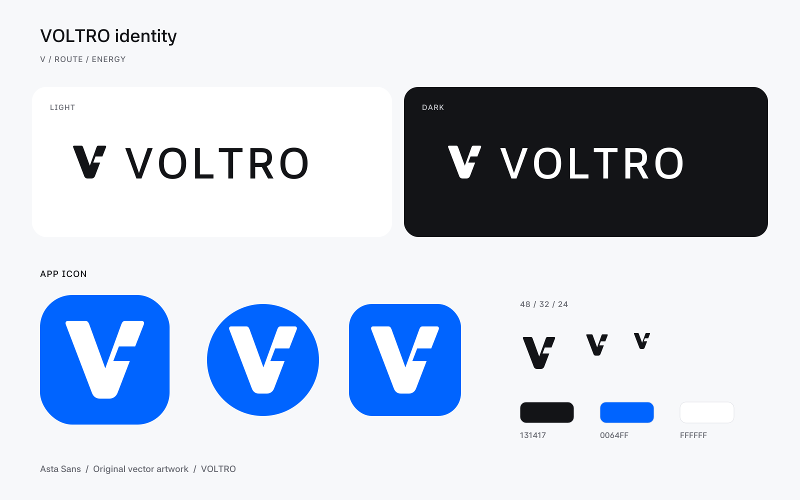

# VOLTRO 로고

경로가 합쳐지는 V 실루엣과 오른쪽의 에너지 흐름을 하나로 연결한 자체 제작 로고입니다. 작은 차량 화면에서도 형태가 남도록 채움형 심볼과 둥근 모서리를 사용했습니다. 워드마크는 앱과 같은 Asta Sans 600을 사용하며, SVG 안의 글자는 경로로 변환했습니다.



## 파일

- `voltro-mark-ink`, `voltro-mark-white`, `voltro-mark-blue`: 투명 배경 심볼, SVG 및 1024px PNG
- `voltro-lockup-ink`, `voltro-lockup-white`: 투명 배경 심볼과 워드마크, SVG 및 1600px 너비 PNG
- `voltro-app-icon`: 청색 배경의 앱 아이콘 미리보기, SVG 및 1024px PNG
- `voltro-brand-overview`: 주야간 로고·아이콘·색상 미리보기, SVG 및 PNG

밝은 화면에는 ink `#131417`, 어두운 화면에는 white `#FFFFFF`를 사용합니다. 앱 아이콘은 blue `#0064FF` 배경에 흰색 심볼을 사용합니다. 심볼 주위에는 48 단위 기준 최소 8 단위의 여백을 둡니다. 가로세로 비율을 유지하며, 꺾임을 제거하거나 임의의 그림자·외곽선을 더하지 않습니다.

## Android 적용

`scripts/build_brand_assets.py`의 48×48 기준 경로가 SVG·PNG와 Android `ic_voltro.xml`의 공통 원본입니다. Adaptive icon은 108×108 전경과 배경을 분리하고, 심볼 전체를 중심 66 단위 안전 원 안에 배치했습니다. 원형·둥근 사각형 마스크와 monochrome을 지원합니다. 기존 기본 아이콘의 모든 밀도별 WebP도 교체했습니다. 런처의 최종 마스크는 플랫폼이 결정합니다.

Pleos의 [48dp 기반 iconography](https://document.pleos.ai/docs/connect/guide/docs-design/foundations/contents-creation/iconography)와 [adaptive app icon 구조](https://document.pleos.ai/docs/connect/guide/docs-design/foundations/contents-creation/app-icon)를 참고했습니다. Pleos 로고나 공식 아이콘을 복사하지 않았으며, VOLTRO 고유의 심볼입니다.

재생성에 필요한 Python 패키지는 CairoSVG 2.8.2, fonttools 4.68.0, Pillow 13.0.0입니다. CairoSVG는 Cairo 시스템 라이브러리를 사용합니다. macOS에서는 환경에 따라 Cairo의 라이브러리 경로를 지정해야 합니다.

```sh
python scripts/build_brand_assets.py
```

글꼴 라이선스는 [Asta Sans OFL](../../licenses/AstaSans-OFL.txt)에 있습니다.
